# Отчет по лабораторной работе №5 (TypeBot)

## Краткое описание выбранного трека

Я выбрала трек **TypeBot**. Это low-code платформа для создания чат-ботов с визуальным конструктором. Мне понравилась возможность быстро собрать сценарий из готовых блоков и интегрировать его с внешними API через HTTP-запросы.

Мой workspace: `lab5-Kovalevskaya`. Бот создан на основе шаблона "Movie Recommendation" и доработан. Шаблон изначально использует API The Movie DB для получения списка фильмов, постеров и описаний.

## Ссылка на бота или flow

- **Ссылка на бота:** [https://typebot.co/movie-recommendation-1uexsfk](https://typebot.co/movie-recommendation-1uexsfk)
- **Экспорт flow:** `lab5/exports/flow-lab5-Kovalevskaya.json`

## Какие AI-промпты использовались

1. *"Помоги русифицировать шаблон Movie Recommendation, переведи все тексты, названия жанров и кнопки"* — для быстрого перевода.
2. *"Как в TypeBot добавить условие, чтобы проверять переменную favorite_actor на содержание подстроки 'ДиКаприо'?"* — для настройки блока Condition.
3. *"Как сделать GET-запрос к API catfact.ninja и вывести ответ в тексте?"* — для настройки HTTP Request.
4. *"Как изменить цветовую тему бота в TypeBot?"* — для кастомизации.

## Какие блоки/ноды/элементы освоены

- **Bubbles:** `Text`, `Image` (вывод информации и постеров).
- **Inputs:** `Text` (сбор данных, например, любимого актера).
- **Logic:** `Condition`, `Set variable` (ветвления и переменные).
- **Integrations:** `HTTP request` (внешний API).
- **Events:** `Start`, `Reply` (управление диалогом).
- **Внешний вид:** Настройка темы.

## Скриншоты работы

### 1. Русификация шаблона
Перевод меню и жанров на русский язык.
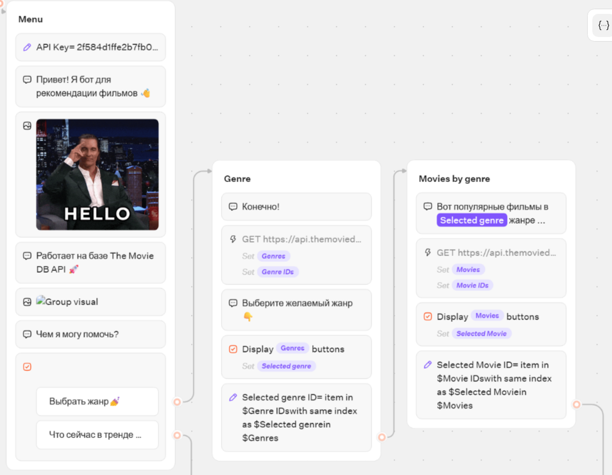
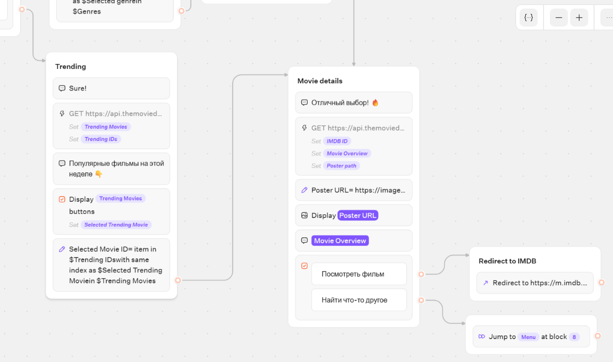

### 2. Проверка базового шаблона
Тестирование стартового экрана, выбора жанра, списка фильмов и перехода на сайт с фильмами IMDb.
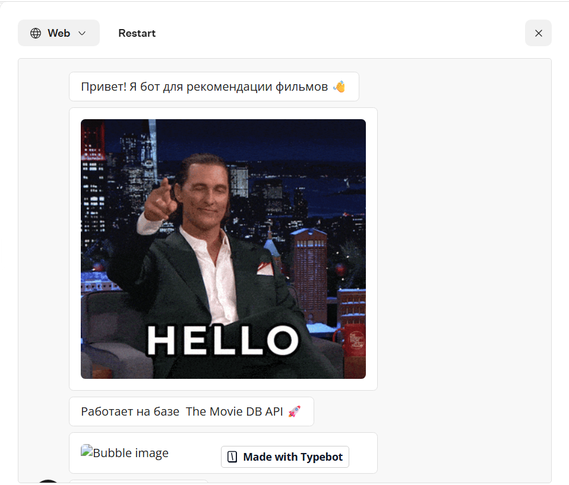
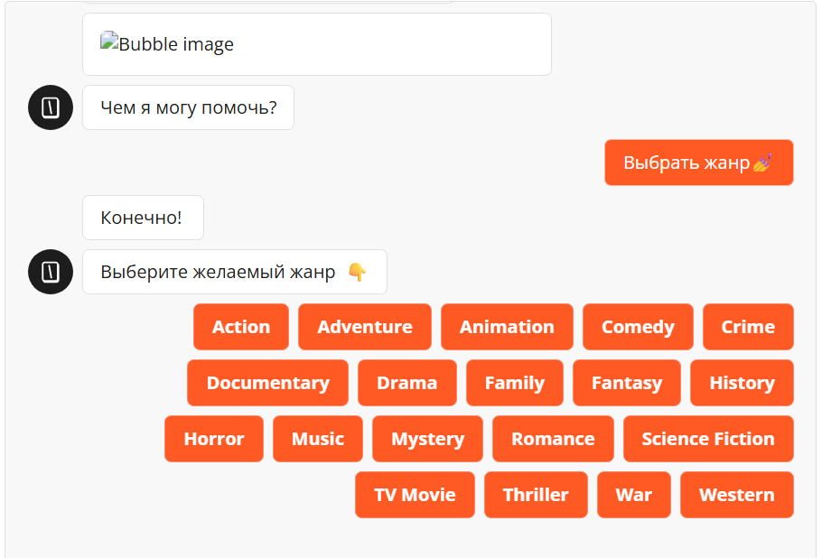
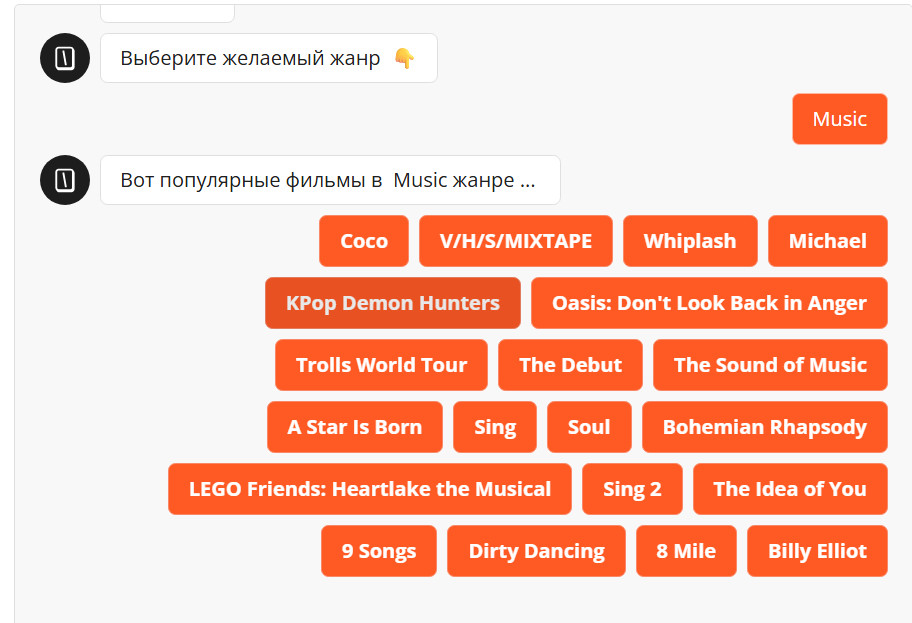
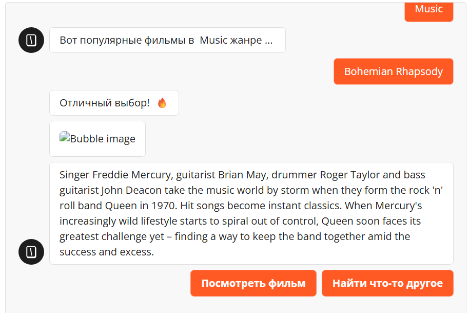
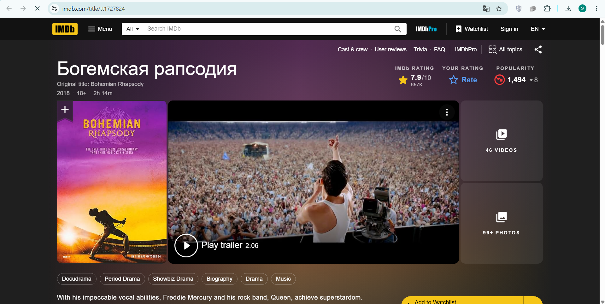

### 3. Модификация: Переменные и Условия
Настройка переменной `favorite_actor` и условия `Contains ДиКаприо`.
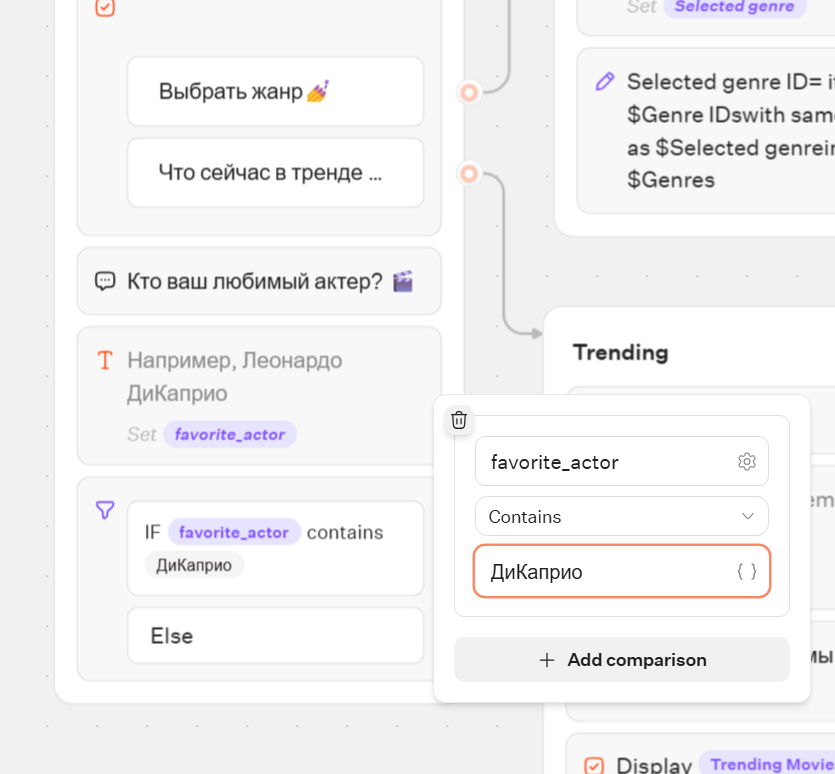
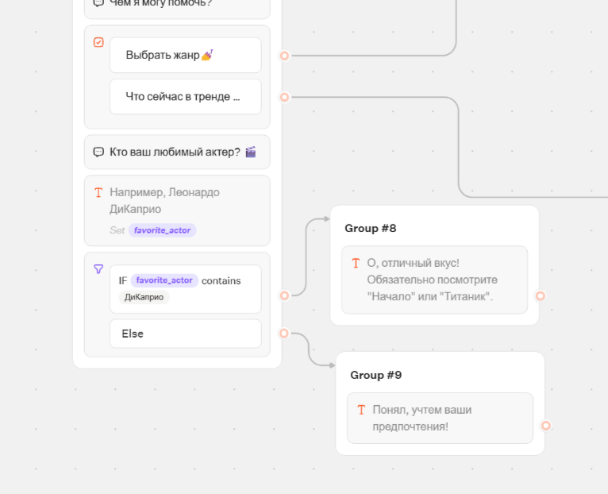

### 4. Модификация: Интеграция (HTTP Request)
Настройка GET-запроса к `catfact.ninja` и проверка успешного ответа.
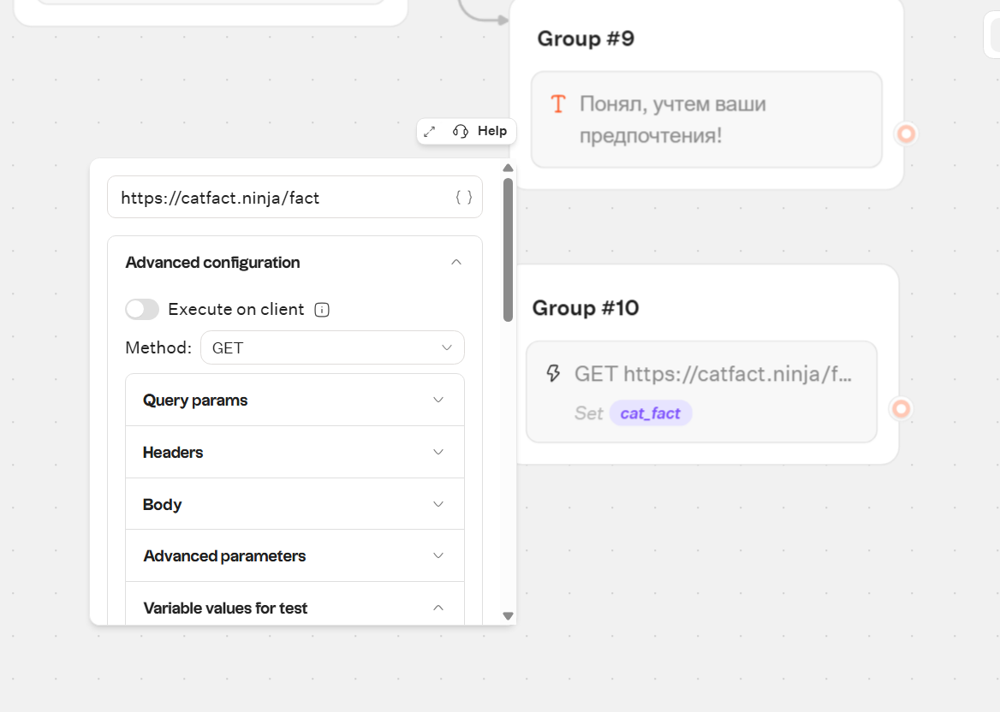
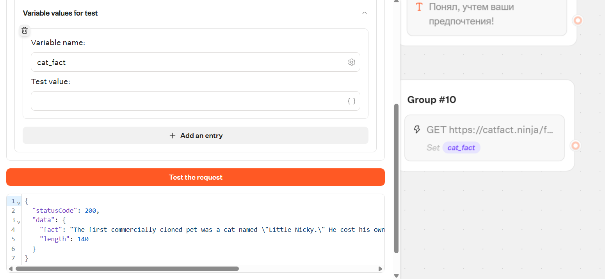
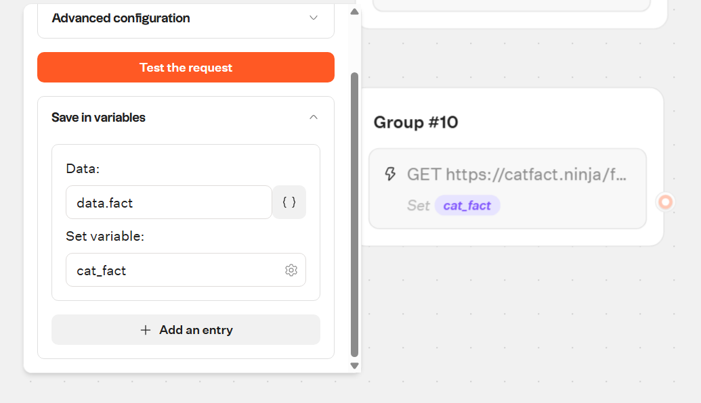
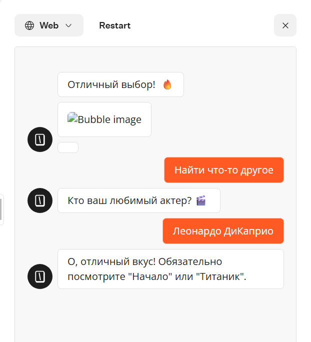
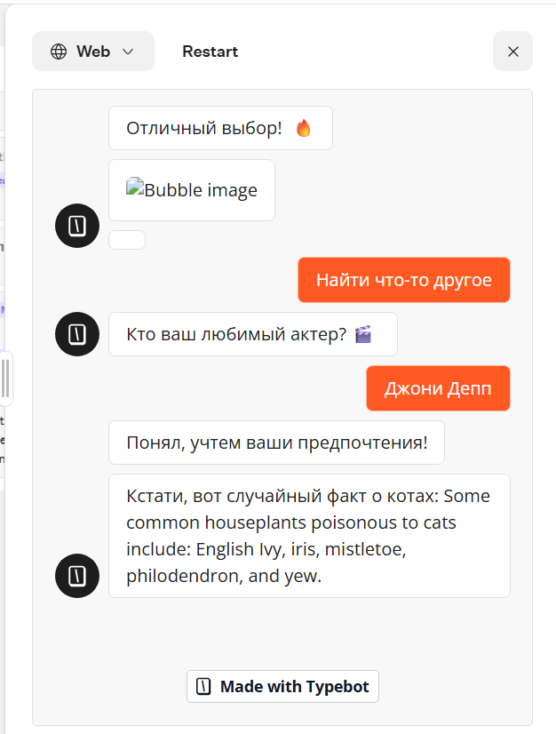

### 5. Соединение логики и проверка работы
Связка конца ветки с фильмами с новым блоком «Кто ваш любимый актер?».
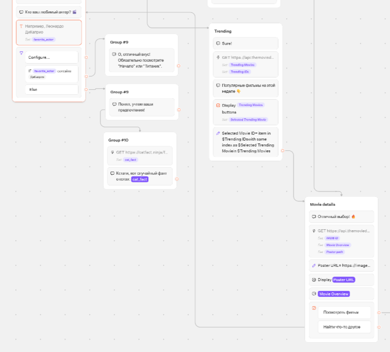

### 6. Кастомизация и Публикация
Смена темы и получение ссылки на опубликованного бота.
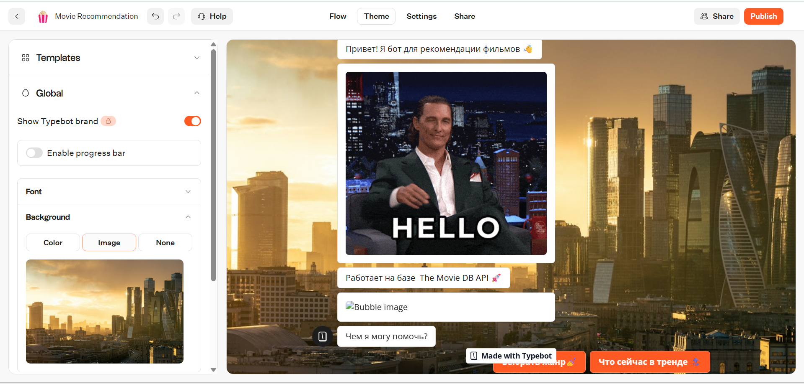
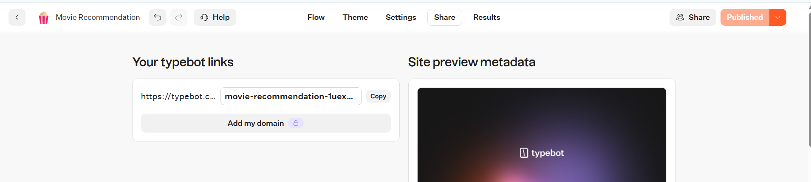

## Выводы

В ходе выполнения лабораторной работы я освоила платформу TypeBot для создания чат-ботов. Я научилась:
1. Создавать бота на основе готового шаблона и русифицировать его.
2. Добавлять новые блоки `Input` и `Text`.
3. Работать с переменными: создавать и сохранять в них ответы пользователя (например, `favorite_actor`).
4. Строить логические ветвления с помощью `Condition`.
5. Интегрировать бота с внешними сервисами через `HTTP Request` (на примере API с фактами о котах).
6. Публиковать бота и экспортировать его flow в JSON.

По сравнению с n8n, TypeBot показался более специализированным и простым инструментом именно для диалоговых интерфейсов. Логика построения сценариев похожа на сборку конструктора. Возможность интеграции через HTTP-запросы делает его мощным инструментом. Работа с Git и GitHub была аналогична предыдущей лабораторной, что помогло закрепить навыки версионирования.