# Лабораторная работа №7. Notion

**Выполнила:** Ковалевская Эмилия
**Группа:** СДП-УИР-241
**Тема:** Освоение Notion как low-code платформы для создания баз данных

## 1. Описание предметной области и модели данных

В качестве предметной области был выбран **«Гоночный уикенд Формулы-1»**. Проект представляет собой планирование и учёт этапов сезона, заездов (сессий), пилотов, а также результатов кругов. Модель данных построена по принципу «звезда» вокруг таблицы-факта «Заезды».

**Модель данных (4 сущности):**
1. **Этапы (Grand Prix)** — конкретный Гран-при. Свойства: Название (Title), Статус (Select), Дата этапа (Date), Длина круга, км (Number), Кругов в гонке (Number).
2. **Заезды (Sessions)** — конкретная сессия (Гонка, Квалификация, Спринт). Свойства: Название (Title), Тип сессии (Select), Дата и время (Date), Длительность, мин (Number), Статус (Select), Дистанция, км (Formula).
3. **Пилоты (Drivers)** — участники соревнований. Свойства: Имя (Title), Команда (Select), Дата дебюта (Date), Номер болида (Number), Очки сезона (Rollup).
4. **Результаты (Results)** — финишные показатели пилота в конкретном заезде. Свойства: Название (Title), Позиция (Number), Время круга, с (Number), Очки (Formula), Пилот (Relation), Заезд (Relation).

**Связи (Relations):**
*   **Этапы ↔ Заезды** (1 : N, двусторонняя) — у этапа несколько сессий, сессия принадлежит одному этапу.
*   **Заезды ↔ Пилоты** (M : N, двусторонняя) — пилот участвует в нескольких заездах, в заезде много пилотов (реализовано через таблицу-факт «Результаты»).
*   **Результаты → Пилоты** и **Результаты → Заезды** (M : 1, двусторонние) — каждый результат относится к одному пилоту и одному заезду.

## 2. Промпт для ИИ и ответ

**Промпт:** 
*«Придумай уникальную предметную область для учебного проекта в Notion. Нужно 3–4 связанные сущности, минимум 2 связи Relation, свойства типов Title, Select, Date, Number, Formula. Опиши модель данных и объясни, зачем нужна каждая связь».*

**Ответ ИИ (дословно):**
> **Учебный проект в Notion: «Формула 1» — гоночный уикенд**
> Планирование и учёт гоночного уикенда Формулы-1: этапы сезона, заезды (сессии), пилоты и команды, а также результаты кругов. Модель — «звезда» вокруг таблицы-факта «Заезды», где формулы считают очки, отставания и загрузку болидов.
> 
> **Сущности и свойства:**
> 1. «Этапы» (Grand Prix): Название (Title), Статус (Select), Дата этапа (Date), Длина круга (Number), Кругов в гонке (Number), Заезды (Relation).
> 2. «Заезды» (Sessions): Название (Title), Тип сессии (Select), Дата и время (Date), Длительность (Number), Статус (Select), Этап (Relation), Пилоты (Relation), Дистанция (Formula).
> 3. «Пилоты» (Drivers): Имя (Title), Команда (Select), Дата дебюта (Date), Номер болида (Number), Очки сезона (Formula), Заезды (Relation), Результаты (Relation).
> 4. «Результаты» (Results): Название (Title), Позиция (Number), Время круга (Number), Очки (Formula), Заезд (Relation), Пилот (Relation).
> 
> **Связи (Relation):**
> 1. «Заезды» → «Этапы» (многие-к-одному). Зачем: группировать уикенд и считать долю завершённых заездов, а также подтягивать параметры трассы для формулы дистанции.
> 2. «Заезды» ↔ «Пилоты» (многие-ко-многим). Зачем: видеть состав участников сессии и связывать пилота с результатами.
> 3. «Результаты» → «Пилоты» и «Результаты» → «Заезды» (многие-к-одному каждая). Зачем: считать очки пилота за сезон (rollup по связи) и ранжировать финишёров внутри заезда.

**Что было исправлено/уточнено в процессе реализации:**
1. **Убрана избыточная связь:** В базе «Заезды» была удалена колонка «Пилоты», так как связь пилотов с заездами уже реализована через базу «Результаты». Это устранило дублирование данных и упростило заполнение.
2. **Скорректированы формулы:** В процессе работы над формулами выяснилось, что Notion не поддерживает прямой доступ к свойствам связанных таблиц без указания `.first()` или `prop()`. Формулы были переписаны с использованием `prop("Этап").first().prop("Кругов в гонке")` и `ifs()` для очков, что сделало их рабочими.
3. **Добавлен шаблон записи:** Для автоматизации ввода результатов был создан шаблон в базе «Результаты», который предзаполняет заезд (Гонка, Мексика) и заголовок, избавляя от ручного выбора связанных записей.
4. **Синхронизация данных:** Были добавлены недостающие пилоты (Колапинто, Лоусон, Гасли) и этап (Гран-при Мексики) для замыкания связей и корректной работы Rollup (очки сезона).

## 3. Освоенные компоненты и настройки Notion

В ходе работы были освоены следующие элементы платформы:
*   Создание страниц и 4 связанных баз данных.
*   Настройка типов свойств: **Title, Select, Date, Number, Relation, Formula, Rollup, Button**.
*   Написание формул (`prop`, `first`, `ifs`, умножение).
*   Настройка Rollup для агрегации данных (сумма очков).
*   Создание представлений **Table** и **Calendar**.
*   Настройка кнопки (Button) с действием автоматического создания записи и предзаполнением полей.
*   Создание шаблона записи (Template) с предзаполненными связями.
*   Публикация страницы в веб (Publish to web).

## 4. Ссылка на проект / Экспорт

*   **Ссылка на опубликованную страницу:** https://app.notion.com/p/lab7-kovalevskaya-notion-40ec2c275ff680bc8effcea423ae323b?source=copy_link
*   **Файл экспорта:** `lab7/exports/lab7-kovalevskaya-notion 40ec2c275ff680bc8effcea423ae323b.md` (сохранен в репозитории).

## 5. Реализованные ачивки

**Ачивка 7: Шаблоны записей**
В базе «Результаты» создан шаблон «Шаблон: Новый финиш». При его использовании автоматически подставляется заезд «Гонка, Мексика» и заголовок `[Имя пилота] — Мексика`. Это исключает ошибку выбора заезда при внесении результатов и ускоряет ввод данных. Поля «Позиция» и «Время круга» остаются пустыми для заполнения пользователем.

## 6. Скриншоты

### Главная страница и сущности
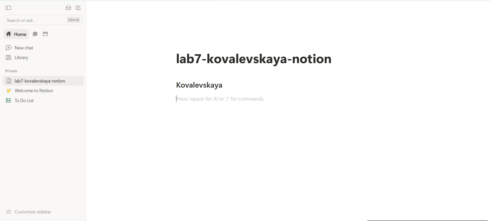
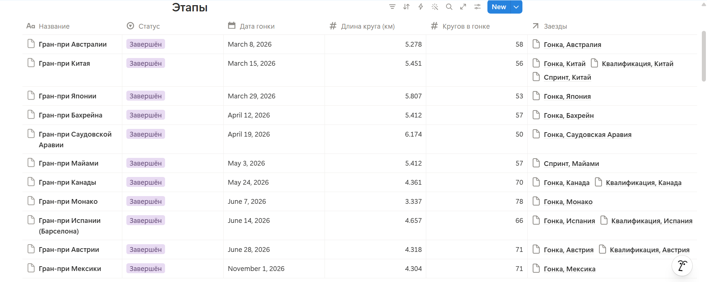
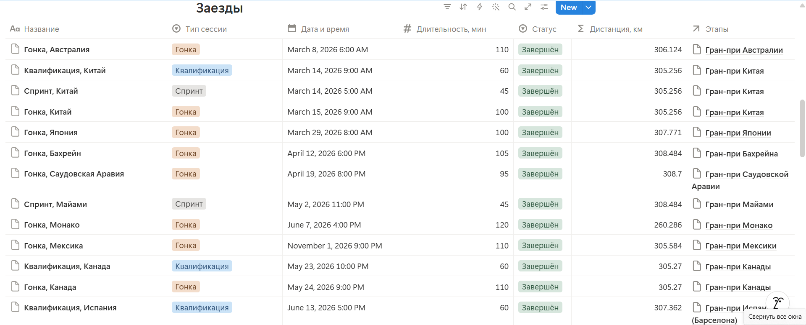
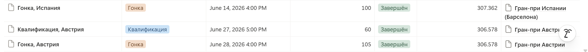
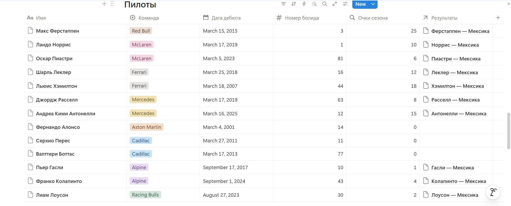
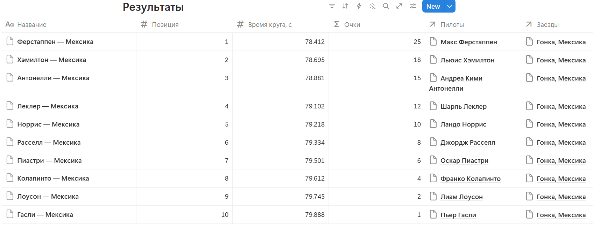

### Представления и кнопки
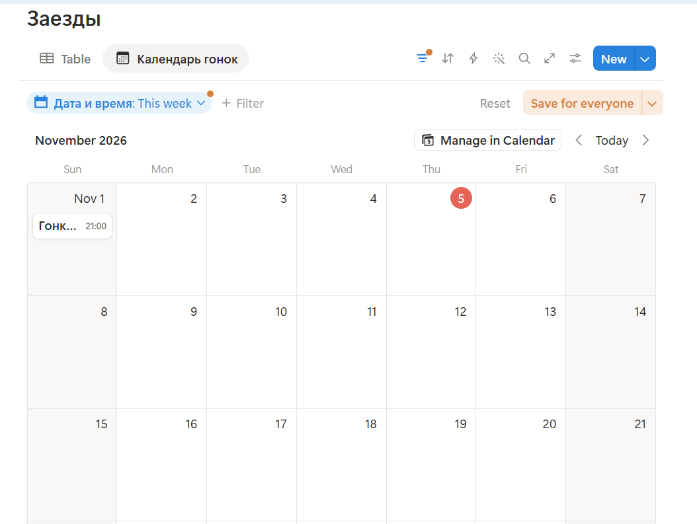
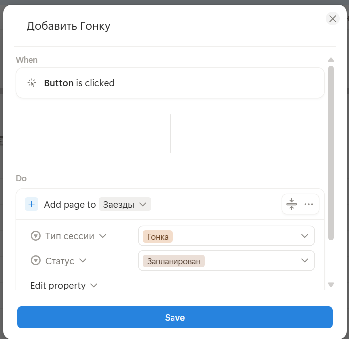

### Ачивка: Шаблоны записей
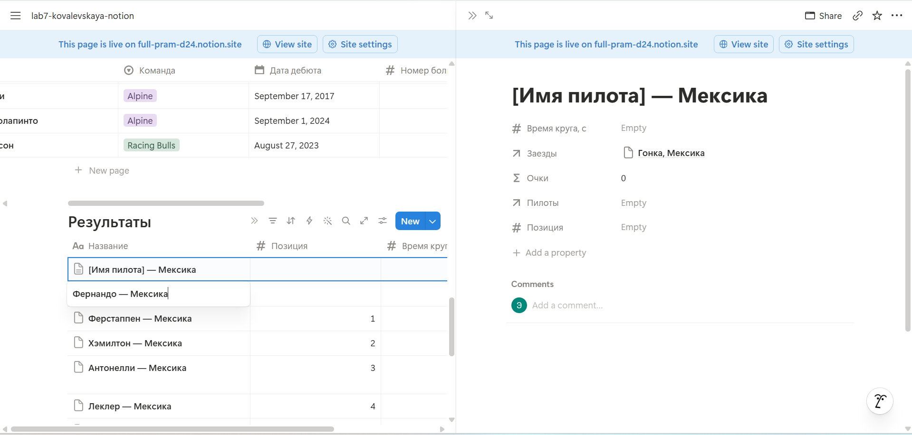

### Публикация и формулы
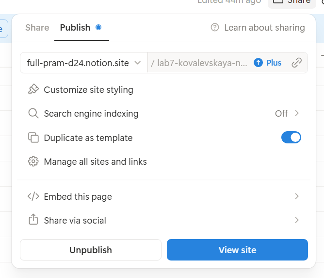
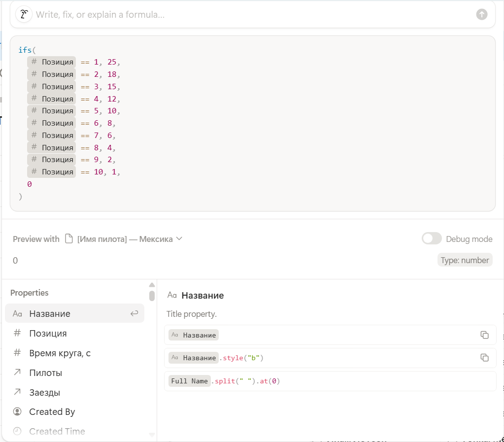
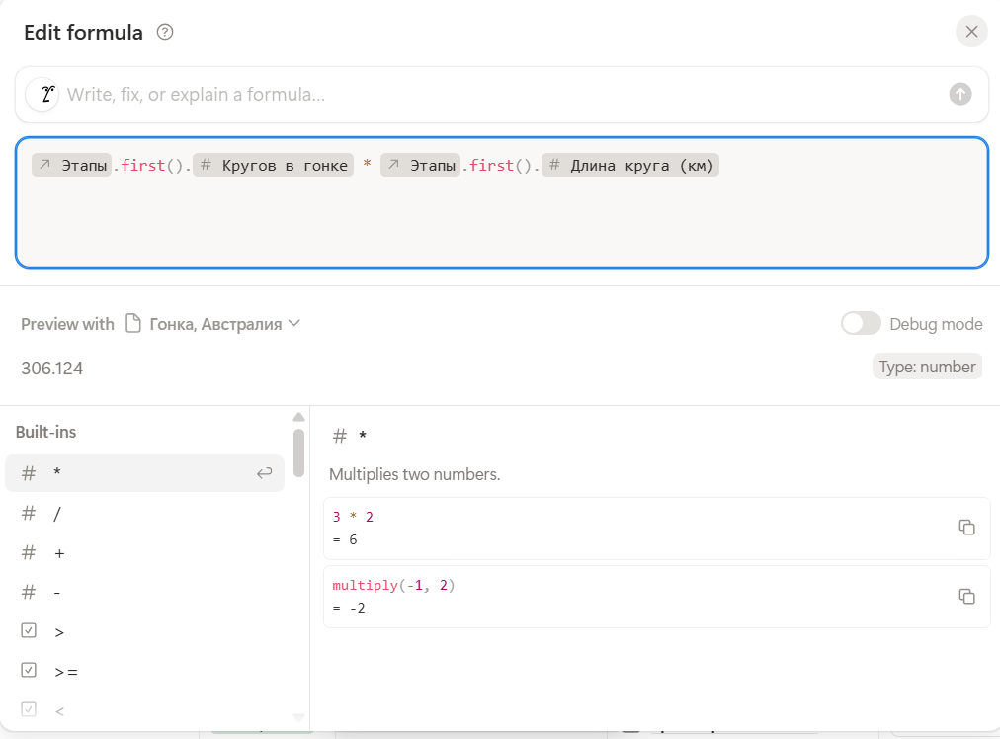

## 7. Выводы

В ходе выполнения лабораторной работы я освоила Notion как полноценную low-code платформу для управления базами данных. Я научилась проектировать модель данных (сущности и связи), настраивать различные типы свойств и писать формулы для автоматических вычислений. 

Особенно полезным было изучение связей (Relation) и роллапов (Rollup) — они позволяют автоматически связывать данные в разных таблицах и суммировать очки пилотов за сезон. Также я освоила создание календарного представления для расписания гонок, настройку кнопок для быстрого добавления записей и создание шаблонов, которые избавляют от рутинного ввода повторяющихся данных. Notion показался мне мощным и гибким инструментом, который отлично подходит для ведения сложных проектов и баз знаний.